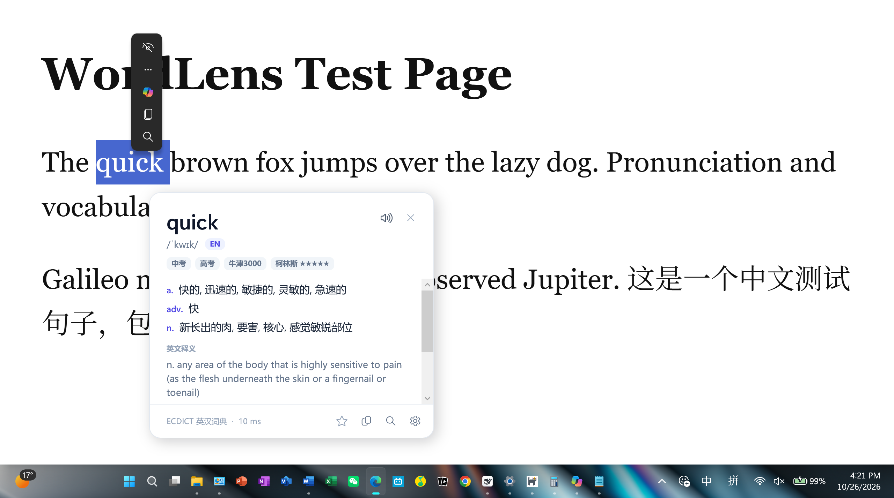
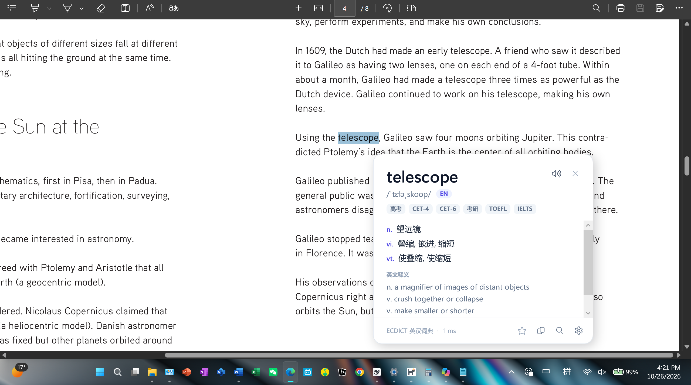
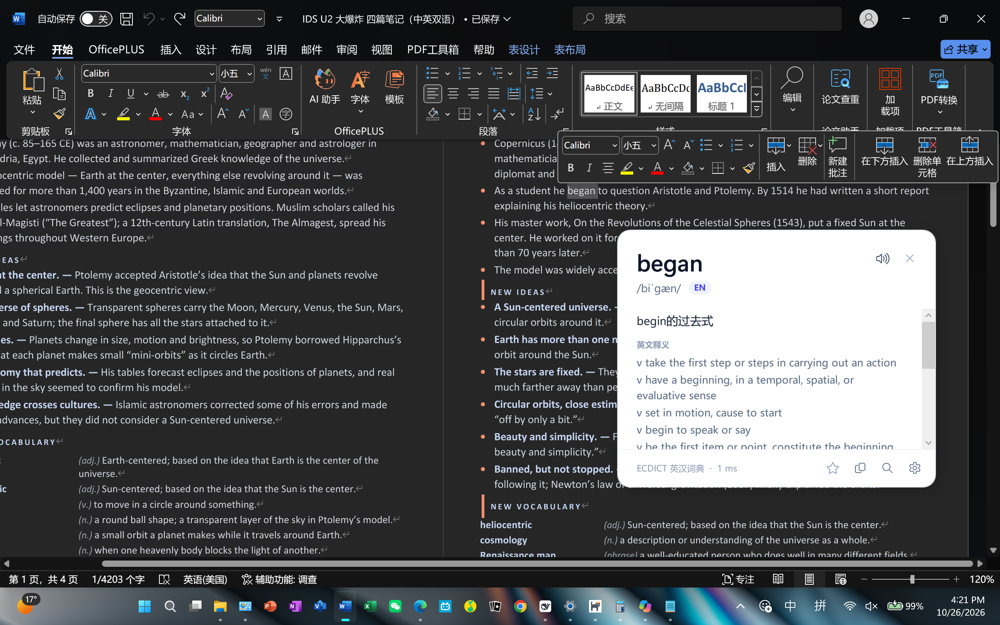
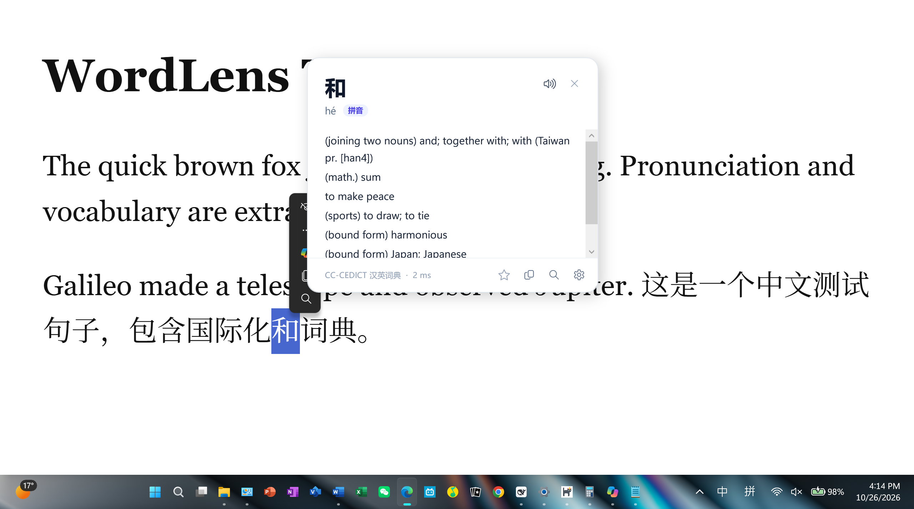
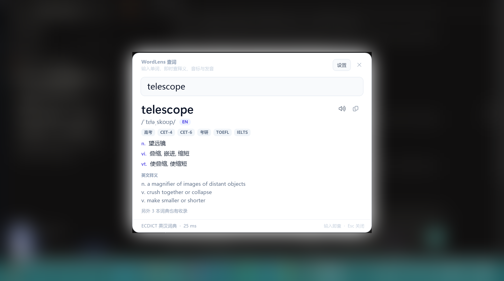
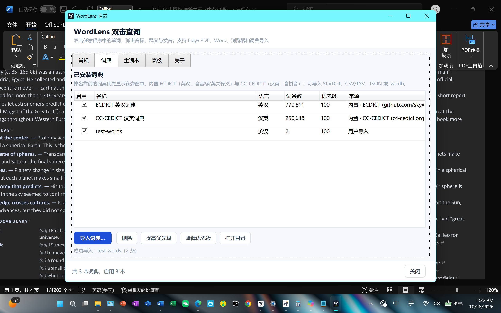

# WordLens

[<kbd>中文</kbd>](README.md) · **English**

macOS Look Up for Windows: double-click an English or Chinese word in **any**
application and a small card appears next to the cursor with IPA or pinyin,
Chinese and English definitions, exam tags and offline pronunciation.

No network connection, no account, no admin rights. Everything runs locally.



## Features

- **Global double-click lookup** — a low-level mouse hook plus the target
  application's own selection; the system double-click behaviour is unchanged.
- **Smart selection capture** — Windows UI Automation (`TextPattern`) first
  (instant, no side effects), clipboard fallback only where needed (Edge's PDF
  viewer). The previous clipboard text is restored.
- **Crash-safe clipboard handling** — Word with an empty selection never gets a
  synthetic `Ctrl+C`; the fallback only writes `CF_UNICODETEXT` and never calls
  `OleFlushClipboard`; after an interrupted fallback the app starts in
  "UI Automation only" mode until the marker is cleared.
- **Hook callbacks do no I/O** — the global mouse hook only enqueues events;
  process checks, logging and UI Automation run on a background thread.
- **Offline dictionaries** — ECDICT (770,611 English→Chinese entries) and
  CC-CEDICT (250,638 Chinese→English rows, simplified + traditional).
- **Standard IPA** — 83,424 English entries carry ipa-dict's US IPA; the rest
  keep ECDICT phonetics, normalised to IPA for display.
- **Inflection fallback** — `perceived`, `running`, `went` resolve to their base
  form via ECDICT's form table, lemma list and suffix rules.
- **Chinese support** — tone-marked pinyin, simplified/traditional, English
  glosses; CC-CEDICT `CL:` measure words are shown as 「量词：位 / 个」.
- **Pronunciation** — Windows SAPI voices (Zira / David / Huihui), adjustable
  rate and volume.
- **Word book and history** — stored in a local SQLite database.
- **Dictionary import** — StarDict (`.ifo` directory or `.zip`), CSV/TSV/TXT,
  JSON/JSONL and WordLens' own `.wlcdb`; enable, reorder, delete, open folder.
- **Hotkeys** — `Ctrl+Alt+D` looks up the current selection at the cursor;
  `Ctrl+Shift+Space` opens a type-to-search window with live results.
- **Per-user install** — `%LOCALAPPDATA%\WordLens`, desktop and Start-menu
  shortcuts, `HKCU` autostart, uninstall entry, single instance, tray icon.
- **Low memory** — the working set is trimmed after 60 s idle (about
  212 MB → 130 MB) without affecting lookup.

| Lookup | Screenshot |
|---|---|
| Edge web page (UI Automation, ~100 ms) |  |
| Edge built-in PDF (clipboard fallback, ~250 ms) |  |
| Microsoft Word (UI Automation, ~10 ms) |  |
| Chinese word with pinyin and measure word |  |
| Type-to-search window (`Ctrl+Shift+Space`) |  |
| Settings → Dictionaries (import, enable, priority) |  |

## Install

Download `WordLens-1.0.0-Setup.exe` from
[Releases](https://github.com/zhyunran/wordlens/releases/latest) and run it.

- Installs for the current user in `%LOCALAPPDATA%\WordLens` — **no UAC prompt**.
- Starts automatically after install, creates desktop and Start-menu shortcuts
  and an `HKCU` autostart entry, and registers an uninstall entry.
- The .NET 8 runtime is bundled; nothing else needs to be installed.
- Re-running the installer upgrades in place and keeps `settings.json`,
  `user.db` and `user-dicts/`.
- The installer is not code-signed. SmartScreen may show "Unknown publisher":
  choose **More info → Run anyway**, or build from source.

Data locations:

| What | Path |
|---|---|
| Program | `%LOCALAPPDATA%\WordLens\` |
| Settings | `%LOCALAPPDATA%\WordLens\settings.json` |
| Logs | `%LOCALAPPDATA%\WordLens\logs\` |
| Imported dictionaries | `%LOCALAPPDATA%\WordLens\user-dicts\` |

Requirements: Windows 10/11 x64.

## Use

1. Double-click a word — in a browser, PDF, Word, Notepad, Excel, a chat client,
   anything that exposes selected text.
2. The card shows IPA/pinyin, definitions, exam tags and the dictionary source.
   Use the speaker to hear it, the star to save it to the word book, the copy
   and search buttons as needed.
3. Dismiss with `Esc`, a click outside the card, or after 30 s of inactivity.
4. To look up a selection without the mouse: press `Ctrl+Alt+D`.
5. To type a word instead: press `Ctrl+Shift+Space` and start typing.
6. The card and the search window both have a **Settings** button; the tray
   icon menu offers pause, settings, word book, search, autostart and exit.

The popup never takes focus, so typing in the application underneath is not
interrupted.

## Dictionary import

Settings → **Dictionaries** → **Import dictionary…** accepts:

| Format | Notes |
|---|---|
| `.ifo` / `.zip` | StarDict dictionaries (`.ifo`/`.idx`/`.dict`, optionally `.dz`; inside a ZIP is fine) |
| `.csv` / `.tsv` / `.txt` | Tabular data; headers `word/单词`, `phonetic/音标/拼音`, `translation/释义`, `definition/英文释义`, `pos/词性`, `tag/标签` are auto-detected. Without a header, the columns are word, phonetic, translation |
| `.json` / `.jsonl` | Array of objects `[{word, phonetic, translation, definition}]`, or a `{"word": "translation"}` map |
| `.wlcdb` | Re-import a WordLens dictionary |

Imports are written to `%LOCALAPPDATA%\WordLens\user-dicts\` and never touch
the built-in dictionaries. Each one can be disabled, reordered or deleted.

Example CSV:

```csv
word,phonetic,translation,definition
WordLens,/ˈwɜːrdlenz/,单词镜头；双击查词工具,a test dictionary entry
```

## Settings

- **Lookup** — enable/pause double-click lookup, post-double-click delay
  (default 150 ms; raise it for slow applications), auto-pronounce.
- **Popup** — auto-close seconds, show English definitions, show exam tags,
  close on outside click, maximum selection length (default 64 characters;
  range 8–400).
- **Startup & history** — autostart at login, lookup history, open the user
  dictionary folder.
- **Dictionaries** — enable, import, delete, raise/lower priority.
- **Word book** — favourites and recent lookups; pronounce or delete.
- **Advanced** — the two global hotkeys, test selection capture, test
  pronunciation, open logs, excluded programs (one process name per line, `*`
  wildcards), restore defaults.
- **About** — data sources and licences.

## Known limitations

- **Elevated applications** (Task Manager, an admin command prompt) do not let a
  normal process read their selection. This is a Windows security boundary;
  WordLens deliberately does not request UAC. Run WordLens as administrator if
  you need it there.
- **PDF relies on the clipboard fallback** because Edge's PDF reader does not
  expose a selection through UI Automation. Only plain text
  (`CF_UNICODETEXT`) is restored, not rich formats. If another program holds
  the clipboard the fallback is skipped (`clipboard busy` in the log); retry.
- **IPA coverage** is 83,424 English entries; other entries show normalised
  ECDICT phonetics.
- **Offline and word-level only** — no sentence translation. Selections longer
  than the configured maximum (default 64 characters) are ignored.
- **Mixed-DPI multi-monitor setups** are not verified.
- The binary is unsigned, so SmartScreen may warn on first run.

## Troubleshooting

- Nothing pops up in a program: check the log. Non-client areas (title bars,
  buttons), the desktop and the taskbar are intentionally filtered.
- Nothing pops up in an admin app: see the limitation above.
- A hotkey does not register: change it in Settings → Advanced; failures are
  logged. `Ctrl+Shift+Space` is the default for the search window; the Copilot
  key (`Win+Shift+F23`) is already registered by Windows (error 1409) and is not
  bound by default.
- To quit completely: tray icon → **Exit WordLens**.
- Restart afterwards if needed: the app starts from
  `HKCU\Software\Microsoft\Windows\CurrentVersion\Run\WordLens`; if security
  software blocks it, run the desktop shortcut.

## Uninstall

Quit WordLens from the tray, then run `uninstall.ps1` in the install directory
(it removes the autostart entry, shortcuts and the program directory), or
manually:

1. Delete `%LOCALAPPDATA%\WordLens`.
2. Delete the desktop and Start-menu `WordLens.lnk` shortcuts.
3. Delete `WordLens` under
   `HKCU\Software\Microsoft\Windows\CurrentVersion\Run`.

Windows Settings → Apps → Installed apps → WordLens → Uninstall uses the same
path.

## Build from source

Requirements: Windows x64, .NET 8 SDK, Python 3.10+ (dictionary build),
PowerShell 5.1.

```powershell
# 1. dictionaries (about 187 MB of SQLite; not committed)
powershell -ExecutionPolicy Bypass -File tools\fetch_data.ps1
python tools\build_dicts.py --raw data\raw --out data\build

# 2. app (self-contained win-x64)
dotnet publish src\WordLens\WordLens.csproj -c Release -r win-x64 --self-contained true -o publish

# 3. installer
powershell -ExecutionPolicy Bypass -File installer\build-installer.ps1 -Version 1.0.0
```

Or run `powershell -File scripts\build.ps1` to do all of it.

Build output goes to `dist\WordLens-1.0.0-Setup.exe`. See
[PACKAGING.md](PACKAGING.md) for the internals (installer payload format,
source ZIP assembly, smoke checks).

## Repository layout

```
src/WordLens/            WPF application
  Core/                  hooks, selection capture, SQLite dictionary, settings, TTS
  Import/                StarDict, CSV/TSV, JSON importers
  UI/                    popup, search window, settings
installer/               per-user installer stub (WinForms, compiled with csc)
scripts/                 one-shot build, install and uninstall scripts
tools/                   dictionary download/build, icon and fixture generators
tests/StarDictTests/     89 unit tests for the StarDict parser
tests/uihelper/          UI Automation helper used for end-to-end checks
docs/                    screenshots
data/README.md           how the offline dictionaries are built
```

## Testing

The StarDict parser is covered by 89 unit tests (`.idx`, `.idx.gz`, dictzip
block boundaries, ZIP bundles, 64-bit indexes, error paths, disposal). The test
project links `src/WordLens/Import/StarDict.cs` directly, so it tests the
shipped code:

```powershell
dotnet run --project tests\StarDictTests\StarDictTests.csproj -c Release
# Result: 89 passed, 0 failed.
```

End-to-end results and the remaining limitations are recorded in
[REPORT.md](REPORT.md).

## Tech

- C# / WPF / .NET 8, self-contained win-x64.
- `WH_MOUSE_LL` low-level mouse hook for double-clicks (physical pixels,
  PerMonitorV2 DPI).
- Selection: UI Automation `TextPattern` first, clipboard fallback for PDF
  (native `CF_UNICODETEXT`, no OLE).
- Dictionary: SQLite, one `.wlcdb` per dictionary (`meta` / `entries` /
  `forms` tables).
- Popup: no-activate top-level window, rounded card, shadow, fade-in.
- Search window: focusable, 120 ms input debounce, same dictionary pipeline.
- Pronunciation: SAPI COM (`SAPI.SpVoice`).
- No network access; all text stays on the machine.

## Data sources and licences

- **ECDICT** — https://github.com/skywind3000/ECDICT — MIT. Chinese/English
  definitions, phonetics, exam tags, frequency, inflected forms (770,611
  entries).
- **CC-CEDICT** — https://cc-cedict.org — CC BY-SA 4.0. Chinese→English,
  pinyin, simplified/traditional (250,638 rows).
- **ipa-dict** — https://github.com/open-dict-data/ipa-dict — MIT. US IPA for
  83,424 English entries.

The application code is MIT (see [LICENSE](LICENSE)). Redistribution of the
built dictionaries must keep the attribution in
[THIRD-PARTY-NOTICES.md](THIRD-PARTY-NOTICES.md); CC-CEDICT data is share-alike.

## Contributing

Issues and pull requests are welcome. This is a small, local-first tool: no
telemetry, no accounts, no background services beyond the tray app itself.
