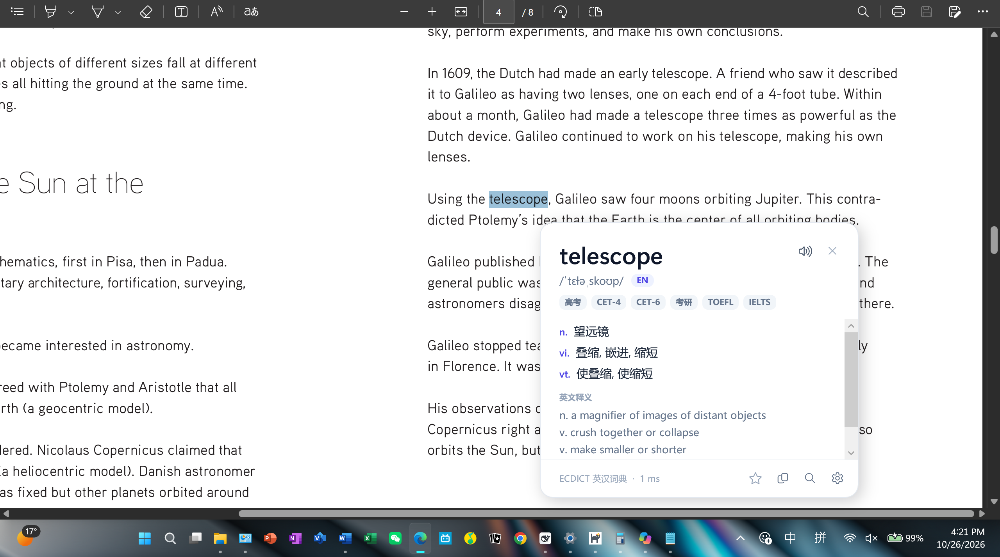

# WordLens 双击查词

[下载 Windows 安装包](https://github.com/zhyunran/wordlens/releases/latest) · [English developer guide](README.en.md)

读英文网页、论文或文档时，双击一个单词，就能在原文旁看到中文释义和音标，也可以点一下听发音。内置英汉和汉英词典，安装后可以离线查词。

## 下载和安装

1. 打开 [最新版本的下载页](https://github.com/zhyunran/wordlens/releases/latest)。
2. 在 **Assets**（附件）里下载 **`WordLens-1.0.1-Setup.exe`**，双击安装。适用于 Windows 11 x64 和 Windows 10 22H2 x64。安装包内置 .NET 运行时和词典，安装到当前用户目录，无需管理员权限。
3. 安装完成后，在任务栏右下角的系统托盘找到 WordLens。它默认随 Windows 登录安静启动。如果图标折叠了，点击托盘旁的上箭头。

已安装 WordLens 的用户可以直接运行安装包升级。设置、生词本、历史和导入的词典都保存在原位置。安装包未签名，发布页附有 SHA-256 校验值。

## 怎么查词

| 想做什么 | 操作 |
| --- | --- |
| 读到生词 | 双击原文中的词，查看释义卡 |
| 手动选了文字 | 按 `Ctrl+Alt+D` 查询当前选区 |
| 直接打字查 | 按 `Ctrl+Shift+Space` 打开输入查词窗口 |
| 发音或收藏 | 点释义卡上的喇叭或星标 |
| 暂停、设置、打开生词本 | 右击托盘里的 WordLens 图标 |
| 导入自己的词典 | 打开「设置 → 词典」，支持 StarDict、CSV、TSV、JSON 和 `.wlcdb` |

按 `Esc` 或点击卡片外部可关闭释义卡。中文词条显示拼音和英语释义。

## PDF 里查不到时

先看阅读器能否高亮并复制完整单词。扫描件需要先做文字识别。遇到阅读器选错字或给不出文字时，可以用输入查词。WordLens 1.0.1 改善了旧选区导致的漏弹，并用阅读器实际复制的文字核对浏览器 PDF 的选区。剪贴板里有图片、文件或富文本时，WordLens 会尝试直接读取选区，以保留剪贴板原有内容。

## 管理本机数据

- **开机自启**可在托盘菜单或设置中切换。
- **数据和日志**在 `%LOCALAPPDATA%\WordLens`。设置为 `settings.json`，生词本和历史为 `user.db`，导入词典在 `user-dicts`。
- **卸载**可在 Windows「设置 → 应用」中进行。卸载会删除这些本机数据，如需留存，请先备份。

## 源码与词典

开发者可以从 [English developer guide](README.en.md) 了解程序结构、选区读取和本地构建。代码采用 [MIT](LICENSE) 许可。内置词典来自 ECDICT、CC-CEDICT 和 ipa-dict，详见 [第三方声明](THIRD-PARTY-NOTICES.md)。
