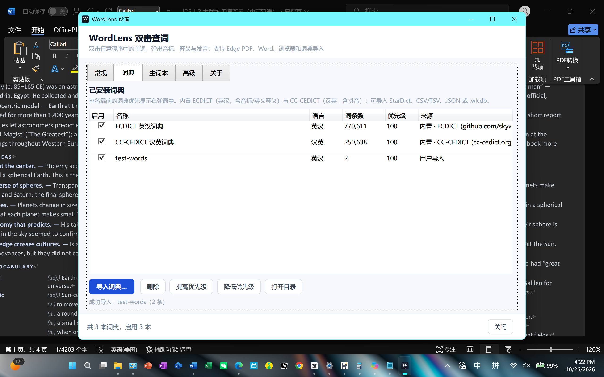

# WordLens

**中文** · [<kbd>English</kbd>](README.en.md)

Windows 上的「macOS Look Up」：在**任意程序**里双击一个英文或中文单词，鼠标旁
立刻弹出小卡片，显示国际音标 / 拼音、中文释义、英文释义、考试标签，并可离线发音。

不联网、不登录、不需要管理员权限，所有文字只在本机处理。


## 功能

- **全局双击查词**：低级鼠标钩子 + 应用自身选词，不改变系统双击行为。
- **智能选区读取**：优先 Windows UI Automation（`TextPattern`，即时、无副作用），
  只在需要时走剪贴板保底（Edge 自带 PDF 阅读器）；用完恢复原剪贴板文字。
- **崩溃加固**：Word 空选区绝不发 `Ctrl+C`；保底只写 `CF_UNICODETEXT`，不调用
  `OleFlushClipboard`；上次保底没有正常收尾时，下次启动自动降级为「仅 UIA」。
- **钩子回调零 I/O**：全局鼠标钩子只入队，进程查询、日志、UI Automation 都在
  后台线程处理，不拖慢整机输入。
- **离线词典**：内置 ECDICT（770,611 条英汉）与 CC-CEDICT（250,638 条汉英，
  简繁双收）。
- **标准音标**：83,424 条英文词条合并开源 ipa-dict 的美式 IPA；其余保留 ECDICT
  音标，显示时做 IPA 规范化。
- **词形还原**：查 `perceived`、`running`、`went` 等变形时自动回退到原形
  （ECDICT 词形表 + lemma 表 + 后缀规则）。
- **中文支持**：带声调拼音、繁体/简体互查、英文释义；CC-CEDICT 的 `CL:`
  量词标记显示为「量词：位 / 个」。
- **发音**：Windows SAPI（Zira / David / Huihui），可调语速、音量。
- **生词本 + 查词历史**：本地 SQLite。
- **词典导入**：StarDict（`.ifo` 目录或 `.zip`）、CSV/TSV/TXT、JSON/JSONL，
  也支持重新导入 `.wlcdb`；可启用/停用、调优先级、删除、打开目录。
- **全局快捷键**：`Ctrl+Alt+D` 直接查当前选中的词；`Ctrl+Shift+Space` 打开
  可打字的「输入查词」窗口，边打边看释义。
- **当前用户级安装**：`%LOCALAPPDATA%\WordLens`，桌面/开始菜单快捷方式、
  `HKCU` 开机自启、卸载项、单实例、托盘常驻。
- **低内存**：空闲 60 秒自动收缩工作集（约 212 MB → 130 MB），不影响查词。

| 场景 | 截图 |
|---|---|
| Edge 网页（UI Automation，约 100 ms） |  |
| Edge 自带 PDF（剪贴板保底，约 250 ms） |  |
| Microsoft Word（UI Automation，约 10 ms） |  |
| 中文词：拼音 + 量词 |  |
| 输入查词窗口（`Ctrl+Shift+Space`） |  |
| 设置 → 词典（导入、启用、优先级） |  |

## 安装

到 [Releases](https://github.com/zhyunran/wordlens/releases/latest) 下载
`WordLens-1.0.0-Setup.exe`，双击安装即可。

- 装到当前用户目录 `%LOCALAPPDATA%\WordLens`，**不弹 UAC**。
- 安装后自动启动，创建桌面/开始菜单快捷方式和 `HKCU` 开机自启项，并注册卸载项。
- 自带 .NET 8 运行时，目标机器不用另装 .NET。
- 重复运行安装包会覆盖升级，保留 `settings.json`、`user.db` 和 `user-dicts/`。
- 安装包未做代码签名：从互联网下载后 SmartScreen 可能显示「未知发布者」，
  点「更多信息 → 仍要运行」即可，或按源码自行构建。

数据位置：

| 内容 | 路径 |
|---|---|
| 程序 | `%LOCALAPPDATA%\WordLens\` |
| 设置 | `%LOCALAPPDATA%\WordLens\settings.json` |
| 日志 | `%LOCALAPPDATA%\WordLens\logs\` |
| 导入的词典 | `%LOCALAPPDATA%\WordLens\user-dicts\` |

系统要求：Windows 10 / 11 x64。

## 使用

1. 在浏览器、PDF、Word、记事本、Excel、聊天软件等任意能选中文字的程序里
   **双击一个单词**（中文词也可以）。
2. 卡片显示音标/拼音、释义、考试标签和词典来源；喇叭发音、星标收藏、
   复制、搜索都在这张卡片上。
3. `Esc`、点击卡片外部、或 30 秒无操作自动关闭。
4. 不想用鼠标选词：选中文字后按 `Ctrl+Alt+D`，直接在鼠标位置弹出释义。
5. 想打字查词：按 `Ctrl+Shift+Space` 打开输入查词窗口，输入英文/中文单词，
   实时显示完整释义。
6. 查词卡片和输入查词窗口都带「设置」按钮；托盘图标右键还有暂停、设置、
   生词本、输入查词、开机启动、退出。

弹窗不抢焦点，不会打断你正在输入的内容。

## 词典导入

设置 → **词典** → **导入词典…**，支持：

| 类型 | 说明 |
|---|---|
| `.ifo` / `.zip` | StarDict 词典（`.ifo`/`.idx`/`.dict`，可带 `.dz`；zip 里是这套结构也行） |
| `.csv` / `.tsv` / `.txt` | 表格词典；自动识别 `word/单词`、`phonetic/音标/拼音`、`translation/释义`、`definition/英文释义`、`pos/词性`、`tag/标签` 表头；无表头时按 单词、音标、释义 处理 |
| `.json` / `.jsonl` | 对象数组 `[{word, phonetic, translation, definition}]`，或 `{"word": "释义"}` 映射 |
| `.wlcdb` | 直接重新导入 WordLens 自己的词典库 |

导入后写入 `%LOCALAPPDATA%\WordLens\user-dicts\`，不会改动程序目录里的内置词典。
可随时停用、调优先级或删除。

示例 CSV：

```csv
word,phonetic,translation,definition
WordLens,/ˈwɜːrdlenz/,单词镜头；双击查词工具,a test dictionary entry
```

## 设置说明

- **查词方式**：启用/暂停双击查词；双击后等待毫秒（默认 150，个别程序选词慢
  可调大）；自动朗读。
- **弹窗行为**：自动关闭秒数、显示英文释义、显示考试标签、点击外部关闭、
  最大选中长度（默认 64 字符，范围 8–400）。
- **启动与历史**：登录自启、查词历史、打开用户词典目录。
- **词典**：启用、导入、删除、提高/降低优先级。
- **生词本**：收藏列表、最近查词、朗读/删除。
- **高级**：两个全局快捷键、测试选区捕获、测试发音、打开日志、排除程序
  （每行一个进程名，支持 `*`）、恢复默认。
- **关于**：数据来源与版权说明。

## 已知局限

- **管理员权限窗口**（任务管理器、管理员命令行）不允许普通权限进程读取选区，
  这是 Windows 的安全边界；WordLens 刻意不申请 UAC。需要覆盖时以管理员身份
  运行 WordLens。
- **PDF 依赖剪贴板保底**：Edge 的 PDF 阅读器不通过 UI Automation 暴露选区，
  因此走「`Ctrl+C` → 读 `CF_UNICODETEXT` → 还原纯文本」；不还原富格式。
  剪贴板被别的程序占用时会跳过（日志里是 `clipboard busy`），可重试。
- **标准 IPA 覆盖 83,424 条**英文词条，其余显示经规范化的 ECDICT 音标。
- **离线、词级查词**，不做整句翻译；选中长度超过设置上限（默认 64 字符）不弹窗。
- **多显示器混合 DPI** 未验证。
- 安装包未签名，首次运行可能有 SmartScreen 提示。

## 排错

- 某个程序双击没反应：先看日志。标题栏/按钮等非客户区、桌面和任务栏会被
  主动过滤，不会触发。
- 管理员程序里不弹：见上面的局限。
- 快捷键冲突：设置 → 高级 里换一个组合；日志会记录注册失败。输入查词默认
  `Ctrl+Shift+Space`；`Copilot` 键对应 `Win+Shift+F23`，已被 Windows 自己占用
  （注册返回错误 1409），所以默认不绑定。
- 想完全退出：托盘图标右键 → **退出 WordLens**。
- 重启后：通过 `HKCU\Software\Microsoft\Windows\CurrentVersion\Run\WordLens`
  自启；若被安全软件拦截，手动双击桌面快捷方式即可。

## 卸载

关闭 WordLens（托盘右键退出），然后运行安装目录里的 `uninstall.ps1`
（会删除自启项、快捷方式和整个程序目录），或手动：

1. 删除 `%LOCALAPPDATA%\WordLens`。
2. 删除桌面与开始菜单的 `WordLens.lnk`。
3. 删除注册表 `HKCU\Software\Microsoft\Windows\CurrentVersion\Run` 下的
   `WordLens`。

Windows 设置 → 应用 → 已安装的应用 → WordLens → 卸载 走的是同一条路径。

## 从源码构建

需要：Windows x64、.NET 8 SDK、Python 3.10+（构建词典）、PowerShell 5.1。

```powershell
# 1. 词典（约 187 MB SQLite，不入库）
powershell -ExecutionPolicy Bypass -File tools\fetch_data.ps1
python tools\build_dicts.py --raw data\raw --out data\build

# 2. 程序（自包含 win-x64）
dotnet publish src\WordLens\WordLens.csproj -c Release -r win-x64 --self-contained true -o publish

# 3. 安装器
powershell -ExecutionPolicy Bypass -File installer\build-installer.ps1 -Version 1.0.0
```

或直接运行 `powershell -File scripts\build.ps1` 一次做完。

产物在 `dist\WordLens-1.0.0-Setup.exe`。安装器内部结构、源码包组装、冒烟检查
见 [PACKAGING.md](PACKAGING.md)。

## 仓库结构

```
src/WordLens/            WPF 程序
  Core/                  钩子、选区读取、SQLite 词典、设置、发音
  Import/                StarDict、CSV/TSV、JSON 导入器
  UI/                    弹窗、输入查词、设置
installer/               当前用户安装器外壳（WinForms，csc 编译）
scripts/                 一键构建、安装、卸载脚本
tools/                   词典下载/构建、图标与测试数据生成
tests/StarDictTests/     89 个 StarDict 解析器单元测试
tests/uihelper/          端到端测试用的 UI Automation 助手
docs/                    截图
data/README.md           离线词典的构建说明
```

## 测试

StarDict 解析器有 89 个单元测试（`.idx`、`.idx.gz`、dictzip 分块跨界、ZIP 包、
64 位索引、错误路径、Dispose 行为）。测试工程用
`<Compile Include="..\..\src\WordLens\Import\StarDict.cs">` 直接链接正式源码，
测的就是交付代码：

```powershell
dotnet run --project tests\StarDictTests\StarDictTests.csproj -c Release
# Result: 89 passed, 0 failed.
```

端到端实测结果和未验证项记录在 [REPORT.md](REPORT.md)。

## 技术实现

- C# / WPF / .NET 8，自包含 win-x64。
- `WH_MOUSE_LL` 低级鼠标钩子检测双击（物理像素，PerMonitorV2 DPI）。
- 选区：UI Automation `TextPattern` 优先 → PDF 专用剪贴板保底
  （原生 `CF_UNICODETEXT`，不走 OLE）。
- 词典：SQLite，每本词典一个 `.wlcdb`（`meta` / `entries` / `forms` 表）。
- 弹窗：无激活顶层窗口，圆角卡片、阴影、淡入，不抢焦点。
- 输入查词：可聚焦独立窗口，输入防抖 120 ms，复用同一套词典/排序/发音。
- 发音：SAPI COM（`SAPI.SpVoice`）。
- 不联网；所有文字只在本地处理。

## 数据来源与许可

- **ECDICT** — https://github.com/skywind3000/ECDICT — MIT。中英文释义、音标、
  考试标签、词频、词形（770,611 条）。
- **CC-CEDICT** — https://cc-cedict.org — CC BY-SA 4.0。汉英释义、拼音、简繁
  （250,638 条）。
- **ipa-dict** — https://github.com/open-dict-data/ipa-dict — MIT。83,424 条
  英文词条的美式 IPA。

程序代码为 MIT（见 [LICENSE](LICENSE)）。重新分发构建好的词典数据库时，
请保留 [THIRD-PARTY-NOTICES.md](THIRD-PARTY-NOTICES.md) 中的署名；
CC-CEDICT 数据需按 CC BY-SA 4.0 共享。

## 参与

欢迎提 Issue 和 PR。这是一个小而本地的工具：没有遥测、没有账号，除了托盘
程序本身没有别的后台服务。
